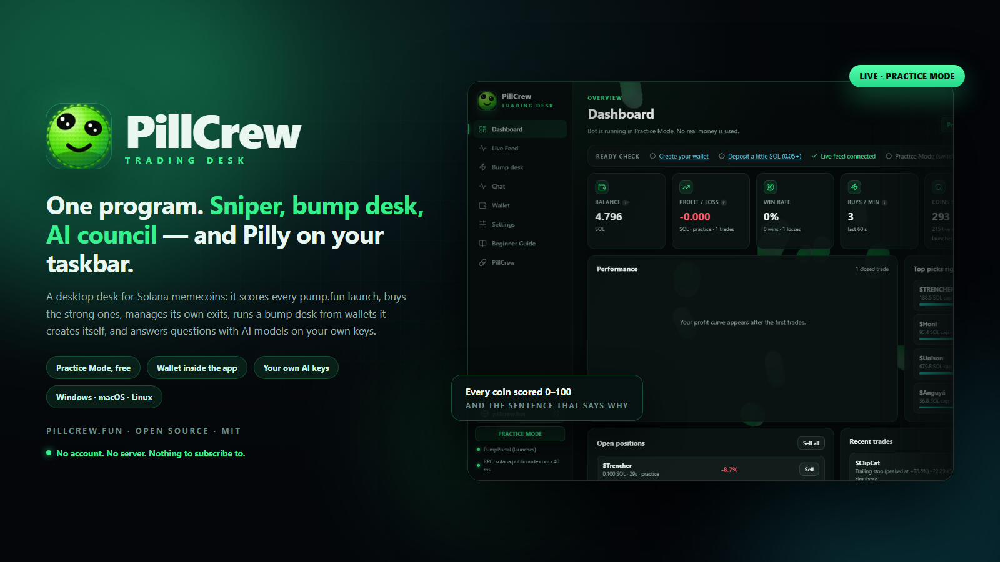
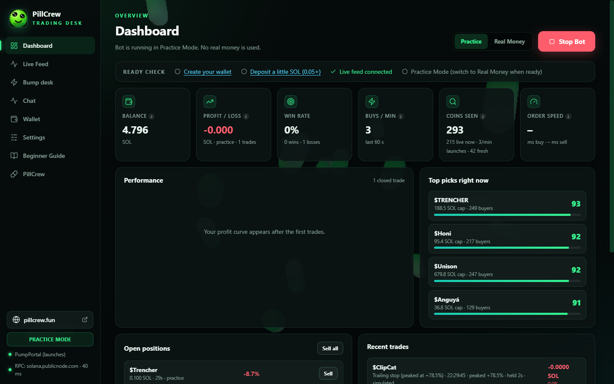
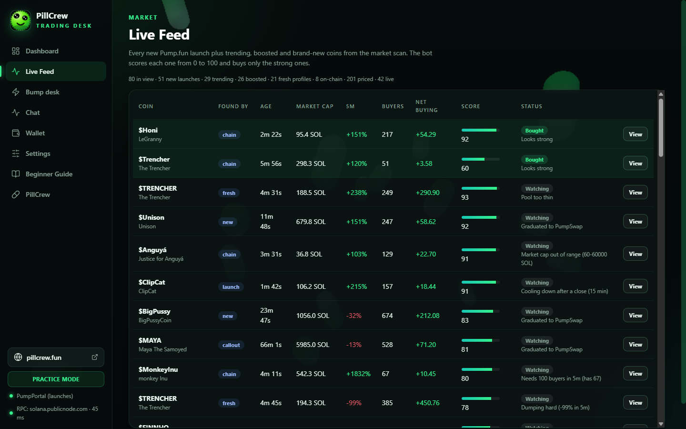
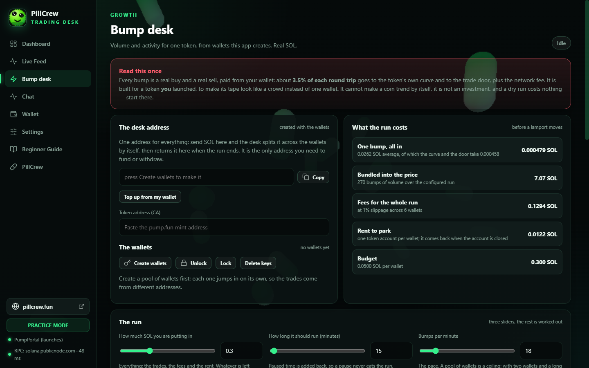
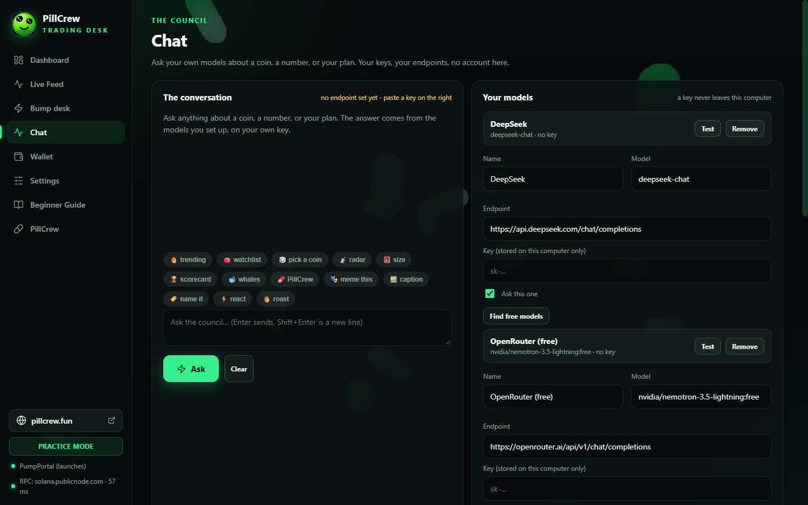
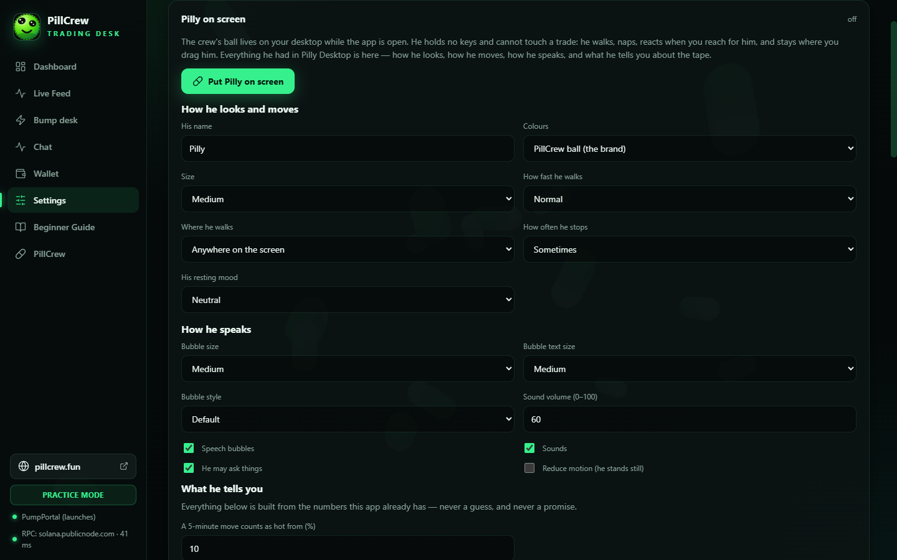
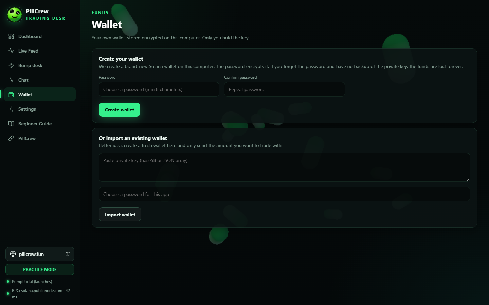
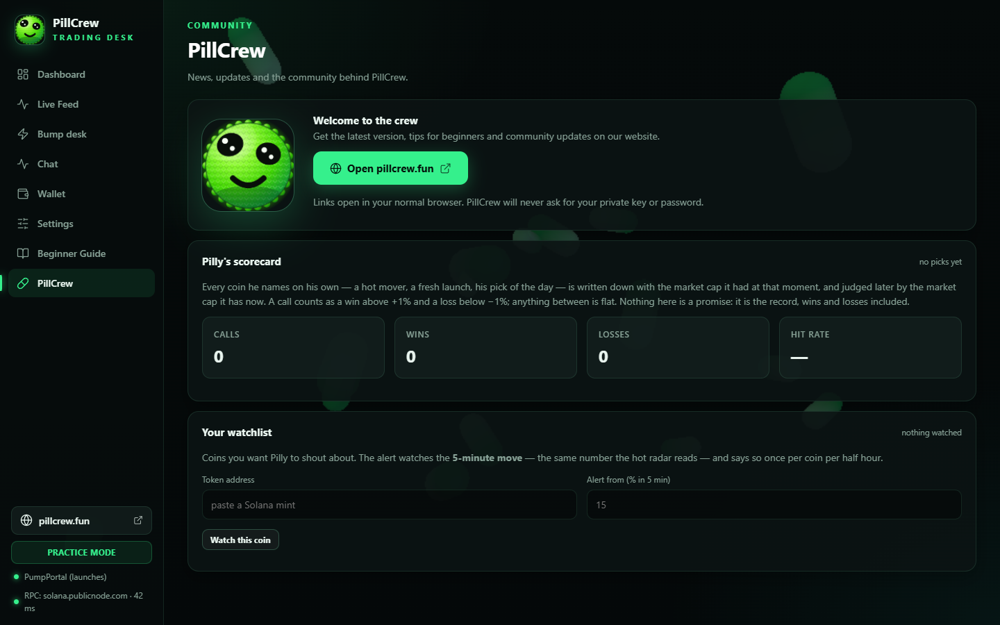
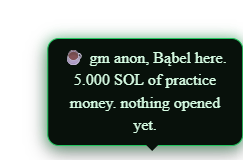

<div align="center">



# 💊 PillCrew

**One program for Solana memecoins.** A pump.fun sniper, a bump desk run from wallets it creates itself, an AI council on
your own keys — and Pilly, a small green pill who lives on your taskbar and tells you what the tape is doing.

**Windows · macOS · Linux** · no account · no server · no subscription · your key never leaves the machine

[](https://github.com/PillCrew/PillCrew/releases)
[](https://github.com/PillCrew/PillCrew/actions/workflows/ci.yml)
[](LICENSE)
[](https://nodejs.org/)
[](#install)

📦 **[Download the latest release](https://github.com/PillCrew/PillCrew/releases/latest)** ·
🌐 **[pillcrew.fun](https://pillcrew.fun)** ·
📖 **[Docs](docs/)** ·
📝 **[Changelog](CHANGELOG.md)**

</div>

---

> **Trade small while you learn.** Practice Mode is free and uses fake SOL. Meme coins are extremely risky and most of
> them lose value. This is a tool, not a promise: nobody — here or in any other repository — has a verified profit figure,
> and this README will not pretend otherwise. Only ever trade what you can afford to lose.

## One program now

This repository used to hold two products: **Pilly Desktop**, the mascot with the free-AI chat, and **PillCrew Sniper**,
the trading desk. They were the same idea with two installers and two sets of settings, so they are now **one program** —
`PillCrew`. Everything Pilly could do is inside it, in the same window, on the same wallet, with the same settings file:

| Was | Is now |
| --- | --- |
| `PillCrew Sniper` (trading desk) | **Dashboard, Live Feed, Bump desk, Wallet, Settings** — same rules, same engine |
| `Pilly Desktop` (mascot + chat) | **Chat** (the council, with every chip and every switch) and **Pilly on screen** (the whole mascot configuration) |
| two installers, two profiles | one installer, one profile. A profile from the old `PillCrew Sniper` is **copied across on first boot** (`migrateOldProfile`); nothing is deleted |

The old Pilly Desktop source is not gone — it is in this repository's history, and its art, prompts and settings live here
now. The old `pillcrew-sniper` repository is retired: this one is the program.

## What it looks like

Every picture is the shipped program with real market data, in Practice Mode. Nothing is a mock-up.

| The dashboard | The live feed |
| --- | --- |
|  |  |

| The bump desk | The council (chat) |
| --- | --- |
|  |  |

| Pilly's whole configuration | The wallet |
| --- | --- |
|  |  |

| Pilly's scorecard and your watchlist | Pilly says something |
| --- | --- |
|  |  |

## Install

| Platform | File |
| --- | --- |
| **Windows 10/11** | `PillCrew-<version>-win-x64.exe` — installs for your user, no admin rights. `PillCrew-<version>-portable-win-x64.exe` runs without installing |
| **macOS 12+** | `PillCrew-<version>-mac-<arch>.dmg` — Intel (`x64`), Apple silicon (`arm64`) or `universal` |
| **Linux x64** | `PillCrew-<version>-linux-x86_64.AppImage`, or `PillCrew-<version>-linux-amd64.deb` |

Prebuilt files are on the [releases page](https://github.com/PillCrew/PillCrew/releases/latest). The builds are **not code
signed**, so:

- **Windows:** SmartScreen may show *"Windows protected your PC"* once — *More info → Run anyway*. On a machine with
  **Smart App Control** turned on, an installer that arrived from the internet (it carries Mark-of-the-Web) can be blocked
  outright; the portable file, or a build made on your own machine, is the way round it. Nothing here needs elevation, a
  driver or a service.
- **macOS:** right-click → **Open** the first time, or `xattr -dr com.apple.quarantine /Applications/PillCrew.app`.
- **Linux:** `chmod +x` the AppImage. If FUSE is missing, use the `.deb` or `--appimage-extract-and-run`.

### Run from source (all three systems)

Node.js **22 or newer** — no native modules to compile.

```sh
git clone https://github.com/PillCrew/PillCrew.git
cd PillCrew
npm ci        # downloads Electron once (~100 MB) and copies three.js into renderer/vendor
npm start
```

[docs/INSTALL.md](docs/INSTALL.md) covers the Linux FUSE requirement, the macOS quarantine flag, Wayland scaling and every
common error.

## First run — five steps

1. The app opens in **Practice Mode** with 5.000 fake SOL. Press **Start Bot** and watch it work: nothing real is at risk.
2. **Wallet → Create your wallet**, choose a password. The key is encrypted on this computer (AES-256-GCM, scrypt) — and
   **export it and keep it offline** when you are offered, because without it those funds cannot be recovered.
3. Deposit a **small** amount of SOL and switch to **Real Money**. Keep the ticket small until you have seen real exits land.
4. Optional: **Chat → Your models** — paste a DeepSeek or OpenRouter key and press *Find free models*; the panel asks the
   provider what it actually offers and picks the best free one. Or point it at your own endpoint.
5. Optional: **Settings → Pilly on screen** — put him on the desktop. He holds no keys and cannot touch a trade.

## What it does

### The sniper (Dashboard · Live Feed)

It watches every new coin on **Pump.fun** and **PumpSwap** — the program's own log stream, PumpPortal, and an optional
market scan — and scores each one **0–100**. Coins are judged four times a second and exits are measured forty times a
second. A coin that traded in the last 1.2 s is priced from its own tape, so an entry reaches the order in about a quarter
of a second.

- **Every coin on one screen**, with its score, buyers, net buying and **the sentence that says why** it was refused — a
  quiet book is a decision, not a mystery.
- **One press sets a working plan.** *Best Profit* writes a full preset (entry bar, exit ladder, exposure limits) and
  **stops there** — it never starts the bot for you, and everything it writes stays editable.
- **Exits that run themselves:** take profit, stop loss, trailing exits, holding limits, adaptive exits.
- **Your own doors:** FluxRPC, Helius, any Solana RPC plus a separate WebSocket, PumpDev, Jupiter, Sol Incinerator. All
  optional, all local, none ever put in a settings code.
- **Honest books:** Practice results and real trades are separate ledgers, and a measured exit uses the wallet's own SOL
  delta from the confirmed sale.
- **Copy trading** by wallet, and a creator-sale / concentration / mint-and-freeze-authority screen before anything is
  bought.

### The bump desk

Volume and activity for **one token**, from a pool of wallets this app creates itself. It is the honest version of what a
"volume bot" is usually sold as — every bump is a **real buy and a real sell**, paid from your wallet, about 3.5 % of each
round trip going to the token's own curve and the trade door plus the network fee. It cannot make a coin trend by itself.

- **One address for everything.** You send SOL to the desk address; it splits that SOL across the pool wallets and every
  lamport comes back to it when you withdraw.
- **Three sliders and the ticket is worked out for you** — how much SOL goes in, how long the run lasts, how many bumps a
  minute — with the cost of the whole run shown before a lamport moves.
- **The end of a run is clean:** bags sold, emptied token accounts closed so their rent returns, everything home.
- Read **[docs/BUMP.md](docs/BUMP.md)** before you touch it. It is the longest document in this repository on purpose.

### The council (Chat)

Your own models, your own endpoints, no account anywhere. Every usable tier is asked **in parallel**; one `VETO` refuses
the coin, the first real answer is the read, and a tier that fails is reported as failed — **silence is never consent**.

- **Thirteen quick actions** — trending, watchlist, pick a coin, radar, size, scorecard, whales, PillCrew, meme this,
  caption, name it, react, roast. The numbers a chip needs are assembled **in the main process** from the app's own state,
  so the page can never tell a model what a number is.
- **Find free models** asks the provider what it actually offers — models come and go, so the panel reads the live list
  instead of trusting a hard-coded name — and picks the best free one.
- **Yours to shape:** editable instructions, five bubble styles, three text sizes, always-on-top, and a reply language you
  can lock.
- **Keys stay here.** Stored on this computer, never printed in the panel (`key set` / `no key`), never written into a
  shareable settings code, and only `http(s)` endpoints are accepted.

### Pilly on screen

The mascot from Pilly Desktop, with its whole configuration: name, colours, size, how fast he walks, **where** he walks
(across the screen or along the taskbar line), how often he stops, his resting mood, speech bubbles (size, text size, six
styles), his voice and volume, reduce motion, and what he is allowed to tell you.

He walks without leaving the screen, turns around short of the corner, is spooked by a fast hand, naps when you are away,
and **stays where you drag him**. What he says is built from numbers this app already has — the **hot radar** (the hottest
5-minute mover above a dust floor), the **fresh launch watch**, the **morning brief**, **his pick of the day**, **whale
alerts** and **his mood**, which follows your PnL. His **scorecard** writes down every coin he names with the market cap it
had, and settles it later against the market cap it has now: a win above +1 %, a loss below −1 %, flat in between, and an
unpriced coin stays open. Wins and losses both — a record that only lists wins is marketing.

### The wallet

Create, import, back up, deposit, withdraw, sell everything and **recover the rent locked in empty token accounts** —
inside the app, without a terminal and without pasting a key into a website. The key file is encrypted with a password you
choose and never leaves the profile folder (`%APPDATA%\PillCrew`, `~/Library/Application Support/PillCrew`,
`~/.config/PillCrew`).

### Your watchlist

Up to twenty coins with a bar on the **5-minute move** — the same number the hot radar reads — one alert per coin per half
hour, said out loud by Pilly in a bubble.

## Why this one, when the market is full of scripts

| | |
| --- | --- |
| **You can see it think** | Score, buyers, net buying and the reason for every refusal, on one screen. |
| **The wallet is inside** | No terminal, no key pasted into a website, no custody anywhere but your machine. |
| **It runs at desktop speed** | A local engine and your own RPC — not a browser tab on somebody else's server. |
| **Practice first** | Free fake SOL, a separate ledger, and one switch to real money when you are ready. |
| **It does not lie about its odds** | [docs/COMPARISON.md](docs/COMPARISON.md) puts this app next to the popular open-source pump.fun bots capability by capability — and names where we lose instead of hiding it. |

## Build your own installers

```sh
npm ci
npm run dist:win     # NSIS installer + portable .exe
npm run dist:mac     # .dmg   (-- --universal for one file for Intel and Apple silicon)
npm run dist:linux   # AppImage + .deb
```

Output lands in `dist/`. [docs/BUILD.md](docs/BUILD.md) has the details, including signing and notarising.

## Tests

```sh
npm test             # the whole suite: no network, no key, no wallet that holds anything
npm run test:ui      # the real window against a mock wallet, trading stopped
```

The suite covers the engine and the chain, the market, exits, guards, wallet encryption, sharing codes, Jito, the curve
maths, the Geyser stream, the connection doctor, copy trading, Jupiter, the AI council, Pilly's brain and his behaviour on
screen, the bump desk and the audit path — plus a boot test that starts the real application and refuses any startup
error. UI behaviour is proven with probes that drive the shipped window over the DevTools protocol: for example
`scripts/chat-probe.mjs` runs the chat end to end against a local stub provider (no key spent) and
`scripts/pet-packaged-proof.mjs` proves the mascot's whole configuration inside the packaged build.

## Documentation

| Document | What is in it |
| --- | --- |
| [docs/INSTALL.md](docs/INSTALL.md) | Every install, platform quirk and common error |
| [docs/SETTINGS.md](docs/SETTINGS.md) | Every setting, what it does, and its safe range |
| [docs/BUMP.md](docs/BUMP.md) | The bump desk in full, including what it costs |
| [docs/AI.md](docs/AI.md) | The council: endpoints, keys, prompt shape |
| [docs/ARCHITECTURE.md](docs/ARCHITECTURE.md) | How the program is put together |
| [docs/COMPARISON.md](docs/COMPARISON.md) | This app next to other open-source pump.fun bots |
| [docs/LATENCY.md](docs/LATENCY.md) | Where the milliseconds go |
| [docs/BACKTESTING.md](docs/BACKTESTING.md) | Running a plan against history |
| [docs/BUILD.md](docs/BUILD.md) | Packaging, signing and notarising |
| [docs/WEB-PLATFORM.md](docs/WEB-PLATFORM.md) · [docs/AGENTS.md](docs/AGENTS.md) | The pillcrew.fun web desk and its ten agents — a separate, browser product |

## Security

- **No telemetry, no account, no server.** The app calls nothing of ours; it talks only to the endpoints you choose.
- **Keys are encrypted locally** with a password you set (AES-256-GCM, scrypt) and never leave the profile folder.
- **AI keys never leave the machine** except to the endpoint you typed, and never enter a shareable settings code.
- **Nothing signs a transaction you did not ask for**, and Practice Mode cannot send one at all.
- Found a security problem? [SECURITY.md](SECURITY.md) says how to report it privately.

## Contributing

Issues and pull requests are welcome — see [CONTRIBUTING.md](CONTRIBUTING.md) and [CODE_OF_CONDUCT.md](CODE_OF_CONDUCT.md).
A change that touches the engine needs a test that fails before it and passes after; a change that touches a number in the
UI needs a screenshot.

## Disclaimer

This software is provided as is, without warranty of any kind. Trading meme coins can lose you all of your money in
minutes. You are solely responsible for the keys, the trades and the taxes in your jurisdiction. Nothing here is financial
advice, and no profit is promised or implied.

MIT licensed — see [LICENSE](LICENSE). Built by [PillCrew](https://github.com/PillCrew) · [pillcrew.fun](https://pillcrew.fun)
